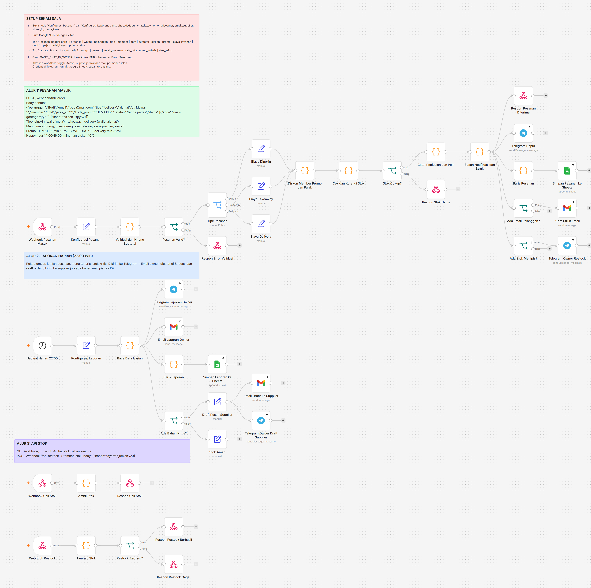

# Project n8n - Otomasi Bisnis F&B

Workflow n8n untuk bisnis F&B: pemesanan, stok bahan, notifikasi, dan laporan harian.



## Isi repo

| Path | Keterangan |
|---|---|
| `workflows/fnb-sistem-pesanan-stok-laporan.json` | Workflow utama (3 alur, 43 node) |
| `workflows/fnb-penangan-error.json` | Error workflow: alert Telegram ke owner |
| `docs/` | Gambar kanvas n8n dan diagram alur |
| `.mcp.json.example` | Contoh konfigurasi MCP `n8n-mcp` (tanpa API key) |

## Fitur

**Alur 1 - Pesanan masuk** (`POST /webhook/fnb-order`)
- Validasi pesanan, hitung subtotal dari daftar menu
- Biaya per tipe: dine-in (service 5%), takeaway, delivery (ongkir per km)
- Diskon member (bronze 5%, silver 10%, gold 15%), promo `HEMAT10` / `GRATISONGKIR`, happy hour 14:00-16:00
- Pajak 10%, poin loyalitas, pengurangan stok otomatis berdasarkan resep
- Notifikasi: Telegram dapur, struk email (Gmail), catat ke Google Sheets, alert stok menipis

**Alur 2 - Laporan harian** (jadwal 22:00 WIB)
- Rekap omzet, jumlah pesanan, menu terlaris, stok kritis
- Kirim ke Telegram + Gmail owner, catat ke Sheets, email order otomatis ke supplier

**Alur 3 - API stok**
- `GET /webhook/fnb-stok` lihat stok
- `POST /webhook/fnb-restock` tambah stok, body `{"bahan":"ayam","jumlah":20}`

## Cara memakai

1. Import kedua file di `workflows/` ke n8n (Workflows -> Import from File).
2. Pasang credential: Telegram, Gmail, Google Sheets.
3. Di node `Konfigurasi Pesanan` dan `Konfigurasi Laporan`, ganti nilai `GANTI_...` (chat ID, email, ID Google Sheet).
4. Buat Google Sheet dengan tab `Pesanan` dan `Laporan Harian` (header ada di sticky note "Setup" pada workflow).
5. Di workflow utama, set Error Workflow ke workflow penangan error, lalu Publish.

## Contoh pesanan

```bash
curl -X POST http://localhost:5678/webhook/fnb-order \
  -H "Content-Type: application/json" \
  -d '{"pelanggan":"Budi","tipe":"delivery","alamat":"Jl. Mawar 5","member":"gold","jarak_km":3,"kode_promo":"HEMAT10","items":[{"kode":"nasi-goreng","qty":2},{"kode":"es-teh","qty":2}]}'
```

## Konfigurasi MCP

Salin `.mcp.json.example` menjadi `.mcp.json`, isi `N8N_API_KEY` dengan key dari n8n (Settings -> n8n API). File `.mcp.json` sudah di-ignore git.

## Catatan

- Stok, omzet, dan poin disimpan di static data n8n (cukup untuk demo; untuk produksi pindahkan ke database/Sheets).
- Menu, harga, dan resep ada di Code node `Validasi dan Hitung Subtotal` dan `Cek dan Kurangi Stok`.
